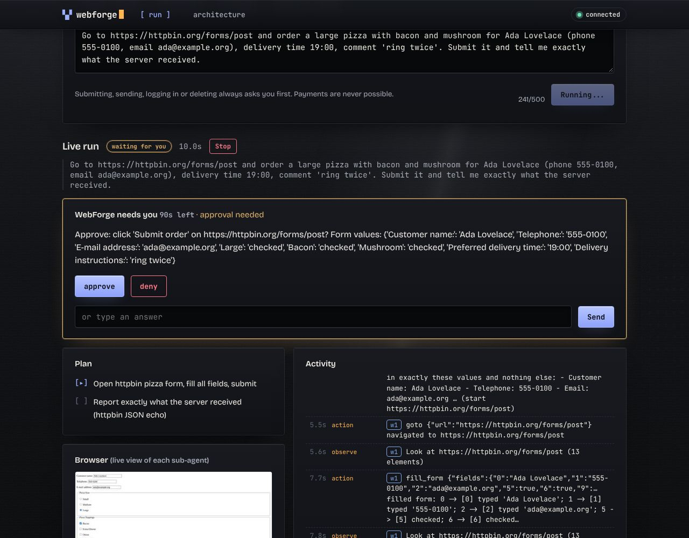
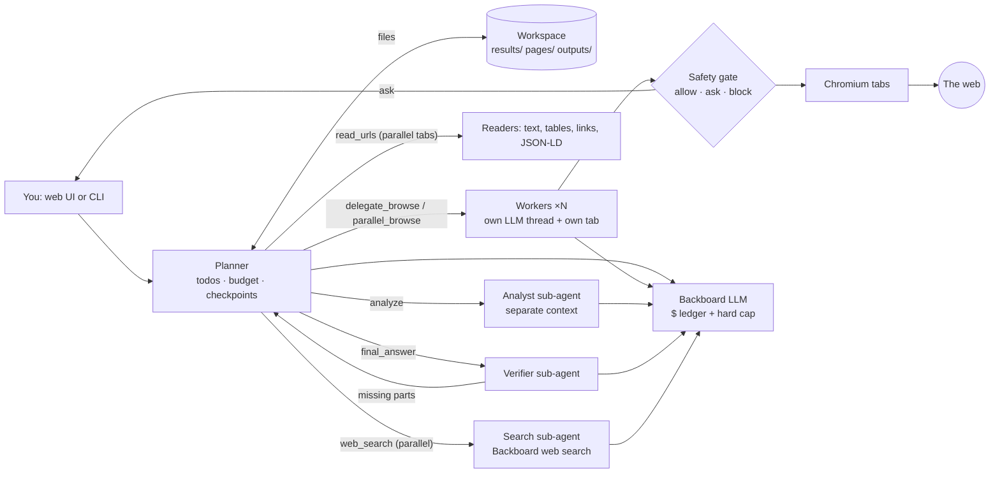

# WebForge

**An autonomous computer-use agent.** Tell it the job in plain language: "fill in this registration form", "compare these three plans and recommend one with a table", "summarize today's top Hacker News stories". It plans, sends parallel sub-agents into real browser tabs to search, read, click and fill forms, **asks you before anything consequential**, **checks its own result**, and hands back an answer plus files.

Built as a *deep agent*: a planner with a todo list and a file workspace, specialised sub-agents with their own context, parallel execution, a human-in-the-loop safety gate, a verifier, and time/cost budgets with checkpoint and resume. The LLM is [Backboard](https://backboard.io) (default `claude-haiku-5-5`); the browser is Chromium via [Playwright](https://playwright.dev).



*The agent filled a real web form in one step, then paused with the exact values and asked for approval before submitting.*

## What it can do

| Kind of task | How WebForge handles it |
|---|---|
| Fill and submit web forms | A worker fills every field in one step by label (`fill_form`), reads validation errors and fixes them, then **asks you to approve** the submit and shows you the values. |
| Log in somewhere | You store the password once as a **secret**; the agent types `{{secret:name}}`, the browser fills the real value, the model and the logs never see it. Logging in needs your approval. |
| Research, compare, decide | Parallel web searches and parallel page reads; an **analyst** sub-agent builds the comparison or decision from the saved pages in its own context; results saved as `outputs/*.md` / `*.csv`. |
| Multi-site / multi-item work | `parallel_browse` runs several browsing sub-agents at once, each with its own LLM thread and its own tab. |
| Long jobs | Per-run time and $ budget (wrap-up at 70 %, hard stop at 100 %), checkpoint after every round, **resume** after a crash or a stop. |
| Anything it cannot do | Payments are always blocked. Captchas, bot walls and logins without a secret are reported honestly instead of guessed. |

## Architecture



Details, tool tables, run sequence and design decisions: [docs/ARCHITECTURE.md](docs/ARCHITECTURE.md). Live-demo script: [docs/DEMO.md](docs/DEMO.md).

## Docker (recommended for a first run)

```bash
git clone https://github.com/Auro-rium/web-forge.git && cd web-forge
docker compose up --build
```

Open <http://localhost:8000>, paste your [Backboard](https://backboard.io) API key into the "Connect Backboard" card, and run a task. If `BACKBOARD_API_KEY` is set in your shell or a `.env` file, it is used instead (precedence: environment variable, then the key saved from the web page).

- **Where the key goes.** The page sends it to your local server, which checks it with Backboard and stores it in `data/backboard_key` (mode 0600). It is never returned by the API. The port is published on `127.0.0.1` only; do not publish it elsewhere without `WEBFORGE_ACCESS_CODE`.
- **What persists.** `webforge-data` (spend ledger, saved key) and `webforge-runs` (events, checkpoints and deliverables of every run). Reset everything with `docker compose down -v`.
- **Headless.** Docker has no display; the web UI shows live screenshots of each sub-agent's tab instead. To watch the real window, run on the host with `--headed`.
- **Troubleshooting.** Port 8000 in use: change the left side of `127.0.0.1:8000:8000`. Chromium crashes: keep `shm_size: 1gb`. Anything else: `docker compose logs -f`.

## Quickstart (laptop, without Docker)

Needs Python 3.11+. On Ubuntu/Debian the command is `python3`, and the venv module is a separate package.

```bash
sudo apt install -y python3-venv            # Ubuntu/Debian only, once
python3 -m venv .venv
source .venv/bin/activate                   # Windows: .venv\Scripts\activate
pip install -r requirements.txt
python -m playwright install --with-deps chromium   # asks for sudo once to install browser libraries
python -m webforge serve --headed           # then open http://localhost:8000
```

CLI:

```bash
python -m webforge run "Compare 3 student laptops under \$1000 and save outputs/laptops.csv"
python -m webforge run "Log in to https://example.com with user ada and the secret site_pw" --secret site_pw=env:SITE_PW
python -m webforge run "<task>" --approval auto     # approve consequential actions automatically (payments stay blocked)
python -m webforge resume <run_id>                  # continue an interrupted run from runs/<run_id>/checkpoint.json
python -m webforge serve-fixtures                   # offline test site (forms, data pages) at http://localhost:8765
python -m webforge run "<task>" --mock              # offline smoke test with the mock LLM
```

In the terminal, questions and approvals pause the live view and wait for your answer (`approve` / `deny` or free text).

## Let it drive your own Chrome (recommended for demos)

By default WebForge runs its own Chromium. To make the agents work **in a Chrome window you can see and use**, start one with remote debugging and point WebForge at it:

```bash
python -m webforge chrome                     # opens Chrome with a dedicated "webforge" profile; prints the next line
export WEBFORGE_CDP_URL=http://127.0.0.1:9222 # Windows: set WEBFORGE_CDP_URL=http://127.0.0.1:9222
python -m webforge serve                      # or: python -m webforge run "<task>"
```

- Every sub-agent works in its **own new tab** in that window. Controlled pages carry a coloured badge ("WebForge · w2 · typing email…"), the tab title is prefixed `[w2]`, and the field being acted on is outlined. When an agent needs you, its tab jumps to the front and the badge turns amber.
- Your own tabs are **never touched**; when the run ends only the agent's tabs are closed (`WEBFORGE_KEEP_TABS=1` keeps them for you to inspect).
- The `chrome` command uses a **dedicated profile** (`~/.webforge/chrome-profile`), because recent Chrome refuses remote debugging on your everyday profile, and because it keeps the agent away from your normal logins. Log in once, in that window, to any site you want it to use; the session persists.
- The safety gate is unchanged and `WEBFORGE_APPROVAL=auto` is refused in this mode unless you set `WEBFORGE_ALLOW_AUTO_REAL_BROWSER=1`.
- Docker cannot see a host Chrome by default; run on the host for this mode (an opt-in example is in `docker-compose.yml`). Troubleshooting: if `chrome` cannot find Chrome set `WEBFORGE_CHROME=/path/to/chrome`; if port 9222 is busy use `--port 9333` and adjust the URL.

## Safety model

| Verdict | Actions | What happens |
|---|---|---|
| **allow** | navigate, read, search, scroll, type into ordinary fields, select options, tick boxes | runs |
| **ask** | submit / send / post / sign up / log in / confirm / delete / book / apply, Enter in a form field, typing a password or secret | pauses and asks you; only `approve` proceeds. Denied or no answer: the agent is told and must not retry |
| **block** | card number, CVV, IBAN, SSN fields; pay / buy now / place order / checkout clicks | never runs, whatever the mode |

`WEBFORGE_APPROVAL=ask` (default) \| `auto` \| `deny` changes only the *ask* row. Page text is treated as untrusted data in every prompt. Secrets are resolved inside the browser at typing time and redacted from traces, events, observations and the UI.

## Configuration

| Variable | Default | Meaning |
|---|---|---|
| `BACKBOARD_API_KEY` | (none) | Backboard key; can also be pasted in the web UI |
| `WEBFORGE_PROVIDER` / `WEBFORGE_MODEL` | `anthropic` / `claude-haiku-5-5` | model routing through Backboard |
| `WEBFORGE_BUDGET_USD` | `3.0` | hard cap on cumulative spend (ledger in `data/spend.json`) |
| `WEBFORGE_RUN_BUDGET_USD` / `WEBFORGE_RUN_DEADLINE_S` | `0.25` / `300` | per-run budget: wrap-up at 70 %, research refused at 100 % |
| `WEBFORGE_APPROVAL` | `ask` | `ask` \| `auto` \| `deny` for consequential actions |
| `WEBFORGE_ASK_TIMEOUT` | `90` | seconds to wait for your answer |
| `WEBFORGE_VERIFY_ROUNDS` | `2` | how often the verifier may send the planner back |
| `WEBFORGE_PARALLEL` | `5` | concurrent sub-agents, tabs and searches |
| `WEBFORGE_SECRET_<NAME>` | (none) | secret values for `{{secret:name}}` |
| `WEBFORGE_SCREENSHOTS` | `1` | live tab thumbnails in the web UI (fallback view when the browser is not on your screen) |
| `WEBFORGE_CDP_URL` | (none) | drive **your own Chrome** (see below); unset = launch a private Chromium |
| `WEBFORGE_KEEP_TABS` | `0` | with your own Chrome: leave the agent's tabs open after the run |
| `WEBFORGE_ALLOW_AUTO_REAL_BROWSER` | `0` | allow `WEBFORGE_APPROVAL=auto` while driving your own Chrome (refused otherwise) |
| `WEBFORGE_ALLOWED_DOMAINS` | `*` (open web) | optional comma-separated navigation allowlist |
| `WEBFORGE_WORKER_STEPS` / `WEBFORGE_PLANNER_STEPS` | `25` / `30` | safety caps per subtask / per run |
| `WEBFORGE_OBS_TEXT` | `4000` | page-text characters per observation (`read(offset)` pages through the rest) |
| `WEBFORGE_ACCESS_CODE`, `WEBFORGE_CORS_ORIGINS` | (none) | server hardening for remote use |

## Project layout

```
webforge/
  agent/planner.py     orchestrator: tools, parallelism, offloading, budgets, checkpoint/resume
  agent/worker.py      browsing sub-agent: observe -> act loop through the safety gate
  agent/verifier.py    verifier sub-agent
  agent/prompts.py     system prompts and tool schemas (planner, worker, analyst, verifier)
  browser/session.py   Browser (process) + Tab (page, trace): actions, fill_form, secrets, readers, screenshots
  browser/observe.py   page -> numbered elements with labels/form details + validation errors
  browser/actions.py   URL normalisation, extraction and selector-free readers
  safety.py            allow / ask / block policy, secrets
  llm.py               Backboard client (tool loop, web search, spend ledger), MockLLM for tests
  server.py            FastAPI: runs, live events (SSE), answers/approvals, secrets, files, cancel, resume
  ui.py, __main__.py   terminal UI and CLI
web/                   static front-end (served by the backend; also deployable to Vercel)
fixtures/site/         offline test pages: forms, data tables, mini wiki
tests/                 offline test suite (MockLLM + fixture site)
```

## Deployment

- **Backend (where the agent runs):** your laptop or any Docker host (`docker compose up`), or Render via `render.yaml`. Set `BACKBOARD_API_KEY`, `WEBFORGE_ACCESS_CODE` and `WEBFORGE_CORS_ORIGINS` there.
- **Front-end only on Vercel:** `vercel.json` serves `web/` statically; enter the backend URL and access code under Connection. The agent itself needs Chromium, so it never runs on Vercel.

## Limitations

- Sites with captchas, bot walls or required logins you have not provided a secret for will stop a sub-agent; the agent reports it and tries other sources.
- No payments, file uploads or downloads by design.
- Answers from web search are only as good as the sources; the verifier checks completeness and unsupported claims, not truth.
- Haiku sometimes replies in prose instead of calling a tool; the planner nudges it (visible as a dim line in the timeline).
- One run at a time per server.

## Testing

```bash
python -m pytest -q          # offline: browser, forms, secrets, safety, planner features, server endpoints
```

Live tests that need a key and network are marked `live` and skipped without `BACKBOARD_API_KEY`.

## License and credits

MIT, see [LICENSE](LICENSE). Copyright (c) 2026 Auro-rium. LLM and web search via [Backboard](https://backboard.io); browser automation via [Playwright](https://playwright.dev).
