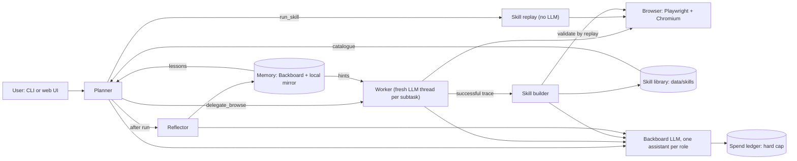

# WebForge

**A web-browsing deep agent that turns what worked into reusable skills, so repeated tasks get cheaper and faster.**


## What it is

WebForge is a planner/worker agent that drives a real Chromium browser through Playwright, using an LLM served by [Backboard](https://backboard.io). When a browsing subtask succeeds, WebForge compiles the recorded trace into a small parameterised JSON *skill*, checks it by replaying it, and saves it; the next similar task runs that skill with no browsing LLM. A reflector also stores short lessons in memory, and a hard dollar cap plus a domain allowlist keep runs cheap and contained. It comes with a live web UI, a CLI, an offline test suite, and a cold-vs-learned benchmark.

## Architecture



Details, sequence diagram and design decisions: [docs/ARCHITECTURE.md](docs/ARCHITECTURE.md).

## How it improves itself

1. **Skill building.** After a worker finishes a subtask successfully, a builder LLM turns the successful steps into a skill: task-specific values (a category name, a search term) become `{param}` templates, and each click carries a robust locator (role+name, placeholder, text, or CSS).
2. **Replay validation.** A candidate skill is saved only if it replays successfully in the live browser with its example parameters. If replay fails, it gets one LLM repair round; otherwise it is discarded.
3. **Reuse.** The planner sees a catalogue of skills and prefers `run_skill`, which executes the steps and extraction without any browsing LLM.
4. **Memory lessons.** After each run a reflector stores 1-3 general lessons (site structure, selectors, pitfalls) that are retrieved for later planning and browsing. Successes and failures are both recorded.
5. **Repair and demotion.** If a skill breaks at run time, WebForge asks the LLM to fix the failing step, re-validates, and bumps the skill version. A skill with at least 3 uses and under 50% success is demoted (hidden from the planner, kept on disk).

Nothing about the model changes; the improvement comes from stored skills and retrieved text.

## Docker (recommended for a first run)

```bash
git clone https://github.com/Auro-rium/web-forge.git && cd web-forge
docker compose up --build
```

Open <http://localhost:8000>, paste your [Backboard](https://backboard.io) API key into the "Connect Backboard" card, and run a task. No `.env` editing is needed. If `BACKBOARD_API_KEY` is set in your shell or a `.env` file next to `docker-compose.yml`, it is used instead and the card does not appear (precedence: environment variable, then the key saved from the web page, then none).

- **Where the key goes.** The page sends it to your local server, which checks it with a cheap Backboard call and stores it in `data/backboard_key` (mode 0600) inside the `webforge-data` volume. It is never returned by the API. The port is published on `127.0.0.1` only, and the save-key endpoint is only enabled because compose sets `WEBFORGE_LOCAL=1`; do not publish the port on other interfaces without also setting `WEBFORGE_ACCESS_CODE`. "Forget saved key" (under Connection) deletes it.
- **What persists.** Two named volumes: `webforge-data` (learned skills, memory mirror, spend ledger, saved key) and `webforge-runs` (run recordings). They survive `docker compose down` and restarts. Reset everything, including the spend cap ledger, with `docker compose down -v`.
- **Headless.** Docker has no display, so the web UI runs Chromium headless there. To watch the browser window (e.g. for a live demo), run on the host instead (see the next section) with `python -m webforge serve --headed`.
- **Settings.** `WEBFORGE_MODEL`, `WEBFORGE_PROVIDER` and `WEBFORGE_BUDGET_USD` pass through from your environment (defaults: `claude-haiku-5-5`, `anthropic`, `3.0`).
- **Troubleshooting.** Port 8000 in use: change the left side of `127.0.0.1:8000:8000` in `docker-compose.yml`. Chromium crashes: keep `shm_size: 1gb`. Anything else: `docker compose logs -f` (also `make docker-up`, `make docker-down`, `make docker-logs`).

## Quickstart (laptop, without Docker)

Needs Python 3.11+. On Ubuntu/Debian the command is `python3`, and the venv module is a separate package.

```bash
sudo apt install -y python3-venv            # Ubuntu/Debian only, once
python3 -m venv .venv
source .venv/bin/activate                   # Windows: .venv\Scripts\activate
pip install -r requirements.txt
python -m playwright install --with-deps chromium   # asks for sudo once to install browser libraries
python -m webforge serve --headed           # then open http://localhost:8000
```

Inside the activated venv, `python` and `pip` work as written. Open http://localhost:8000, paste your Backboard key into the "Connect Backboard" card (or put it in `.env`: `cp .env.example .env`), pick an example task and press **Run agent**. `--headed` opens the real Chromium window so you can watch the agent; leave it out to run the browser invisibly. Next time you only need `source .venv/bin/activate` and the `serve` command.

CLI examples:

```bash
python -m webforge run "List the titles and prices of the 3 cheapest books in the 'Poetry' category on https://books.toscrape.com" --headed
python -m webforge skills list                 # learned skills (also: skills show <name>, skills rm <name>)
python -m webforge memory list                 # stored lessons (also: memory reset)
python -m webforge bench run --mode cold --repeat 3      # live benchmark, spends money
python -m webforge bench run --mode learned --repeat 3
python -m webforge bench report runs/bench_cold_<ts>.jsonl runs/bench_learned_<ts>.jsonl
python -m webforge serve-fixtures              # offline demo site at http://localhost:8765
python -m webforge run "<task>" --mock         # offline smoke test with the mock LLM
```

`make help` lists shortcuts (`make install test serve demo-offline bench report docker-build`).

## Configuration

Set via environment variables or `.env` (see [.env.example](.env.example)).

| Variable | Default | Meaning |
|---|---|---|
| `BACKBOARD_API_KEY` | none | Backboard API key. Required for live runs. |
| `WEBFORGE_PROVIDER` | `anthropic` | LLM provider routed by Backboard. |
| `WEBFORGE_MODEL` | `claude-haiku-5-5` | Model name. |
| `WEBFORGE_BUDGET_USD` | `3.0` | Hard cap on cumulative spend, tracked in a global ledger (`data/spend.json`). LLM calls are refused once reached. |
| `WEBFORGE_ALLOWED_DOMAINS` | books.toscrape.com, quotes.toscrape.com, en.wikipedia.org, news.ycombinator.com, github.com, localhost, 127.0.0.1 | Comma-separated navigation allowlist (subdomains included). |
| `WEBFORGE_CHROMIUM` | auto | Path to a Chromium binary; empty uses Playwright's own. |
| `WEBFORGE_DATA` / `WEBFORGE_RUNS` | `./data` / `./runs` | Skills, memory, state; run artefacts and benchmark JSONL. |
| `WEBFORGE_LEDGER` | `./data/spend.json` | Spend ledger path. |
| `WEBFORGE_WORKER_STEPS` / `WEBFORGE_PLANNER_STEPS` | `25` / `30` | Max browser actions per subtask / planner tool rounds per run. |
| `BACKBOARD_BASE_URL` | `https://app.backboard.io/api` | Backboard endpoint. |
| `WEBFORGE_HEADED` | `0` | `1` shows the real browser window. `serve --headed` and `run --headed` set it for you. |
| `WEBFORGE_ACCESS_CODE` | unset | Server: if set, starting runs and destructive endpoints need header `X-Access-Code`. |
| `WEBFORGE_CORS_ORIGINS` | `*` without a code, none with one | Server: allowed browser origins. |
| `WEBFORGE_MOCK` | unset | Server: `1` uses the offline mock LLM (no key, no spend). |

## Safety and cost controls

- **Domain allowlist.** Navigation (`goto`, including inside skill replay) to hosts outside `WEBFORGE_ALLOWED_DOMAINS` is refused.
- **Blocked actions.** The worker cannot type into password/card/CVV/SSN-like fields, and cannot click checkout, pay, place-order, sign-in/log-in or delete-account controls (regex heuristics on element names).
- **Untrusted page text.** Prompts tell the model to treat page text and tool output as data and not to follow instructions in it. This is a mitigation, not a guarantee.
- **Spend cap.** Every Backboard call checks the global ledger first and raises `BudgetExceeded` at the cap; the server also returns HTTP 402. Benchmarks use isolated data directories but share the same ledger.
- **Server.** Optional access code, closed CORS when a code is set, single concurrent run, 500-character task limit.

## Results

All numbers are from live runs with Claude Haiku 5.5 through Backboard on public practice sites. Sample sizes are small; treat them as indicative, not statistically significant. Methodology and threats to validity: [docs/ARCHITECTURE.md](docs/ARCHITECTURE.md#10-benchmark-methodology-bench).

### Single pair (n = 1 each)

| | Steps | LLM calls | Tokens | Cost | Time |
|---|---|---|---|---|---|
| Poetry books task, cold | 3 | 8 | 2,924 | $0.0030 | 25.5 s |
| Travel books task, with the learned skill | 2 | 4 | 1,310 | $0.0006 | 12.1 s |

The Travel answer was verified against the live site.

### Benchmark 1: 9 tasks, 1 run each

Families: `books_category`, `quotes_by_tag`, `wiki_summary` (3 tasks each).

| | Correct | Mean steps | Mean tokens | Mean seconds | Mean cost |
|---|---|---|---|---|---|
| Cold | 8/9 | 3.4 | 2,115 | 16.9 | $0.0019 |
| Learned | 9/9 | 1.8 | 1,852 | 14.4 | $0.0015 |

By family: Books cold 2/3 correct, 8 steps, 29 s vs learned 3/3, 3 steps, 19 s. Quotes and Wikipedia take about 1 step in both modes (nothing to learn). **The gain is concentrated in the Books family, n = 1 per task, and the single cold failure may be noise.**

### Benchmark 2: 27 tasks per mode (9 tasks x 3 repeats)

Source: `runs/bench_cold_20261124_044017.jsonl` and `runs/bench_learned_20261124_044017.jsonl`. Cells are cold vs learned.

| Scope (n per mode) | Success | Mean steps | Mean tokens | Mean seconds | Mean cost |
|---|---|---|---|---|---|
| **Overall (27)** | 24/27 (89%) vs 27/27 (100%) | 2.85 vs 2.04 | 1,951 vs 1,583 | 15.5 vs 12.0 | $0.0017 vs $0.0011 |
| books_category (9) | 6/9 (67%) vs 9/9 (100%) | 6.44 vs 3.78 | 2,875 vs 1,969 | 26.2 vs 15.7 | $0.0030 vs $0.0014 |
| quotes_by_tag (9) | 9/9 vs 9/9 | 1.00 vs 1.11 | 1,908 vs 1,431 | 11.2 vs 9.9 | $0.0012 vs $0.0010 |
| wiki_summary (9) | 9/9 vs 9/9 | 1.11 vs 1.22 | 1,070 vs 1,348 | 9.1 vs 10.4 | $0.0010 vs $0.0010 |

Reading it honestly:

- The improvement is again concentrated in Books: about 40% fewer steps, 32% fewer tokens, 40% less time, and about 54% lower cost than cold.
- Quotes and Wikipedia show no clear gain. Learned mode took marginally more steps on both (1.11 vs 1.00; 1.22 vs 1.11) and, on Wikipedia, more tokens and time. Quotes used fewer tokens at about the same step count, which I would not attribute to skills at this sample size. There is nothing to reuse when the model already solves the task in about one step.
- All three cold failures are the same task (`books_mystery`, once per repeat): the planner did not finish. It failed in all 3 repeats, so this looks systematic rather than noise; the learned runs finished it every time (with skills carried over from the Poetry and Travel tasks).
- In learned mode, skills persist across repeats, so repeats 2 and 3 can reuse a skill built for the exact same task in repeat 1. Part of the learned advantage is therefore reuse, not only transfer to a new variant.
- Checkers verify answer format (for example three prices), not ground-truth correctness. Differences of one or two tasks are not significant.

### Long-horizon run (n = 1)

Task: Hacker News top 3 stories, open each comments page, write per-story notes, produce `report.md`. Completed in 47.5 s, 7 steps, 14 LLM calls, $0.0056, reusing 2 previously built skills. The numbers in the report were verified against live Hacker News (two stories exact, one within live drift).

**What went wrong:** the first attempt ended "incomplete" (69.9 s, 21 LLM calls). A bug in the planner counted every prose reply toward its nudge limit instead of only consecutive ones. It was fixed (commit `a4ab12a`), and the second attempt above completed.

### Spend

The whole project so far has spent about $0.13 of the $3.00 cap (read from `data/spend.json`, the global ledger).

## Project layout

```
webforge/
  __main__.py        CLI: run, skills, memory, bench, serve, serve-fixtures
  config.py          environment-driven Config
  contracts.py       shared dataclasses and protocols (Observation, Skill, LLM, RunResult, events)
  llm.py             BackboardLLM, MockLLM/ScriptedMock, retry, spend ledger
  memory.py          BackboardMemory (+ JSONL mirror) and LocalMemory
  safety.py          domain allowlist, blocked actions
  server.py          FastAPI: runs + SSE stream, skills/memory/bench endpoints, serves web/
  ui.py              Rich live terminal UI
  agent/             planner (orchestrator), worker (browsing sub-agent), reflector, prompts
  browser/           Playwright wrapper, observation JS + robust locators, actions
  skills/            library (JSON files), builder (LLM), replay (no LLM)
bench/               tasks.yaml, run_bench.py (cold vs learned, checkers, report)
fixtures/            offline demo site + generator (served by serve-fixtures)
web/                 static front-end (Run, Learning, Skills & Memory, Architecture tabs)
scripts/             export_site_data.py (bench/skills/memory snapshots for the static site)
tests/               offline test suite
docs/                ARCHITECTURE.md, DEMO.md
Dockerfile, render.yaml, vercel.json   deployment
```

## Deployment

- **Static site on Vercel.** Import the repo; `vercel.json` sets `outputDirectory` to `web`, so the front-end (UI, recorded-run replay, results, architecture) is served as static files with no build step.
- **Backend on Docker / Render.** `Dockerfile` builds an image with Chromium (Playwright base image) and runs `uvicorn webforge.server:app`; `render.yaml` is a Render blueprint (Starter plan or larger, health check `/api/health`). Set `BACKBOARD_API_KEY`, `WEBFORGE_ACCESS_CODE` and `WEBFORGE_CORS_ORIGINS` (your Vercel URL) as secrets in the dashboard. Without a persistent disk, skills, memory and the spend ledger reset on every deploy.
- In the deployed UI, enter the backend URL and access code in the Connection card.
- **The agent needs Chromium and a Backboard key, so live runs happen on a laptop or a Docker host, not on Vercel.** On Vercel alone the UI is read-only: results, skills, architecture and recorded-run replay.

## Limitations

- Needs a Backboard key and Chromium; live results depend on third-party sites and model variance.
- Evidence is small: 9 distinct tasks on three sites, at most 3 repeats. Checkers test answer format, not ground truth.
- Gains appear only where a task kind repeats and takes several exploratory steps; one-step tasks gain nothing.
- Skills are tied to site structure and are validated only against the live site at build time; a redesign triggers repair (which can fail) or demotion. Demotion is not reversible automatically.
- The allowlist is enforced on navigation actions, not on every network request; risky-click and sensitive-field checks are heuristics; there is no login, payment, CAPTCHA or file-transfer support.
- Small models sometimes reply in prose instead of calling a tool; a nudge mechanism handles most cases but not all.
- One run at a time per server; the spend ledger is not safe against concurrent writers.

## Testing

```bash
python -m pytest -q      # 50 passed, 1 skipped (the skip is the live Backboard round-trip: set `WEBFORGE_LIVE=1` and a key to run it)
```

Tests run fully offline: `MockLLM`/`ScriptedMock` stand in for the model and a local copy of the fixture site stands in for the web. No key, no spend.

## License and credits

MIT, see [LICENSE](LICENSE). Copyright (c) 2026 Auro-rium. LLM and memory via [Backboard](https://backboard.io); browser automation via [Playwright](https://playwright.dev); practice sites by Scrapinghub ([books.toscrape.com](https://books.toscrape.com), [quotes.toscrape.com](https://quotes.toscrape.com)), plus Wikipedia and Hacker News.
