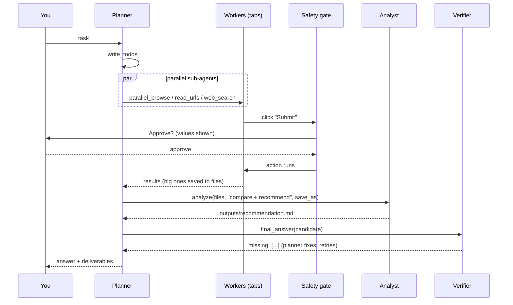

# WebForge architecture

WebForge is an autonomous computer-use agent built as a deep agent: a planner that never touches the browser, specialised sub-agents with isolated context, parallel execution in separate browser tabs, a file workspace instead of an ever-growing context, a human-in-the-loop safety gate, a verifier, and a time/cost budget with checkpoint and resume.

## 1. Goals

1. **Finish real tasks end to end** on the open web: research, comparisons, decisions, and actions such as filling in and submitting forms.
2. **Stay autonomous for minutes** without losing the thread: plan, delegate, keep findings in files, respect a budget, survive interruptions.
3. **Involve the human only where it matters**: genuine ambiguity, and consequential actions (submit, send, log in, delete). Never payments.
4. **Check its own work** before answering.
5. **Stay cheap**: Haiku through Backboard, a hard global $ cap, small contexts.

## 2. Components

| Module | Responsibility |
|---|---|
| `agent/planner.py` | Orchestrator: tool loop, parallel fan-out, offloading big outputs to files, budgets, verifier gate, checkpoint/resume. |
| `agent/worker.py` | Browsing sub-agent: one subtask, fresh LLM thread, own tab; observe → act loop through the safety gate; approvals via the planner's `ask`. |
| `agent/verifier.py` | Verifier sub-agent: checks a candidate answer against every part of the task; fails open on errors. |
| `agent/prompts.py` | System prompts (planner, worker, analyst, verifier) and tool schemas. |
| `browser/session.py` | `Browser` (Chromium process + context) and `Tab` (page, trace, actions, `fill_form`, `check`, secrets, readers, screenshots). |
| `browser/observe.py` | Page → numbered interactive elements with labels, values and form details (`required`, `options=[…]`, `INVALID`, `submit`) plus visible form errors. |
| `browser/actions.py` | URL normalisation, CSS extraction and selector-free readers (`read`, `tables`, `links`, `find`, `structured`). |
| `safety.py` | `allow / ask / block` policy and `Secrets`. |
| `llm.py` | Backboard client (tool loop, web search, spend ledger), `MockLLM` / `ScriptedMock` for tests. |
| `server.py` | FastAPI: runs, SSE event stream, answers/approvals, secrets, deliverables, cancel, resume, key setup. |
| `ui.py`, `__main__.py` | Rich terminal UI (pauses for questions) and the CLI. |

### Planner tools

| Tool | What it does | Parallel |
|---|---|---|
| `write_todos` | checklist shown live in both UIs | - |
| `web_search(queries)` | Backboard call with `web_search="Auto"` (role `searcher`, no browser); short answer + sources per query | one call per query |
| `read_urls(urls)` | opens each URL in its own tab, extracts the readable main content, saves `pages/<host>-<n>.md` | one tab per URL |
| `delegate_browse(subtask, start_url)` | one worker on the default tab | - |
| `parallel_browse(subtasks)` | one worker per subtask, each with its own LLM thread **and** tab | yes |
| `analyze(files, instruction, save_as)` | analyst sub-agent reads workspace files (≤60k chars) in a fresh thread; `save_as` writes `outputs/<name>` | - |
| `write_file`, `read_file(name, offset, limit)` | workspace; `outputs/*` are deliverables | - |
| `ask_user(question, options)` | asks the human; only for real ambiguity or missing personal data | - |
| `final_answer(answer)` | goes through the verifier before the run may end | - |

Concurrency is capped by `WEBFORGE_PARALLEL` (default 4) with an `asyncio.Semaphore`. Worker events carry an `agent` id (`w1`, `w2`, …) shown as colour lanes in both UIs.

### Worker tools

`goto`, `click`, `type(idx, text, submit)`, `fill_form({label_or_idx: value})`, `select`, `check(idx, on)`, `press`, `scroll`, `back`, `read(offset)`, `tables()`, `links(filter)`, `find(text)`, `structured()`, `extract(css, fields)`, `done(success, summary, data)`.

`fill_form` matches keys to fields by idx, then exact label, then case-insensitive containment, and sets each by type (text, dropdown, checkbox/radio). It reports per field, so an unknown label is visible to the model instead of silently ignored. Fields the agent touched are marked, so native validation messages appear under `FORM ERRORS` in the next observation.

## 3. One run

Every round the planner writes `runs/<id>/checkpoint.json` (task, todos, workspace, digest, rounds, spend, elapsed, status).

## 4. Context management

* **Sub-agent isolation.** Each worker, the analyst and the verifier run in their own Backboard thread. The planner only sees their compact reports.
* **Offloading.** Any planner tool output over 3000 characters is written in full to `results/<tool>-<n>.md` and the planner receives a preview plus the file name. Worker `done.data` over 1500 characters goes to `results/<agent>-data-<n>.json`. `read_file` pages with `offset`/`limit`; `analyze` reads files in a separate context. Long jobs therefore keep their findings without the planner's context growing with every page.
* **Observation budget.** Workers see up to 100 elements and `WEBFORGE_OBS_TEXT` (4000) characters of page text; `read(offset)` pages through the rest.

## 5. Autonomy controls

* **Budget.** `WEBFORGE_RUN_BUDGET_USD` (0.25) and `WEBFORGE_RUN_DEADLINE_S` (600). At 70 % of either, a wrap-up note is appended to the planner's tool results. At 100 %, search/read/browse tools are refused and the verifier is skipped, so the run ends with the best answer it has. `planner_max_steps` remains a safety cap; the global $ cap (`WEBFORGE_BUDGET_USD`, ledger in `data/spend.json`) refuses any LLM call once reached.
* **Verifier.** On `final_answer`, the verifier gets the task, the candidate, the last 60 evidence lines and the file index, and returns `{complete, missing, unsupported_claims, verdict}`. Incomplete → the planner is told what is missing and continues, up to `WEBFORGE_VERIFY_ROUNDS` (2) times. Errors or unparsable output fail open, so a broken verifier can never trap a run.
* **Human in the loop.** `ask_user` and worker approvals share one path: `on_ask(question, options)` with a timeout (`WEBFORGE_ASK_TIMEOUT`, 90 s). The server stores a future per question (`POST /api/runs/{id}/answer` resolves it); the CLI pauses the live view and reads stdin. No answer → "proceed with best judgment and state the assumption" for questions, and *not approved* for actions.
* **Resume.** `run_task(..., resume=checkpoint)` rebuilds the workspace, todos and digest, and starts a new planner thread with a state brief (task, todos, file index, last 30 digest lines). Browser tabs are not restored by design. CLI: `python -m webforge resume <run_id>`; web: Resume button (`POST /api/runs/{id}/resume`).

## 6. Safety model (`safety.py`)

| Verdict | Trigger | Effect |
|---|---|---|
| block | typing into card number / CVV / IBAN / SSN fields; clicks such as pay, buy now, place order, checkout | never executed, in any mode |
| ask | clicks named submit/send/post/sign up/register/log in/confirm/delete/book/apply…, submit buttons, Enter in a non-search field, typing a password or a secret | executed only after `approve` (`WEBFORGE_APPROVAL=ask`), always (`auto`), never (`deny`) |
| allow | everything else | executed |

The approval question names the action, the URL and the current form values (secrets shown as `{{secret:name}}`), and the UI shows a fresh screenshot of the tab. **Secrets**: the model writes `{{secret:NAME}}`; `Tab` resolves it at typing time; `Secrets.redact` replaces values in action messages, trace, observations (password inputs show `•••`) and every server event. Secret values set in the web UI live in server memory only. Page text is untrusted in every prompt. An optional domain allowlist (`WEBFORGE_ALLOWED_DOMAINS`) is enforced on navigation, including `read_urls`.

## 7. Backboard integration (`llm.py`)

* **Assistants per role** (`webforge-planner`, `-worker`, `-searcher`, `-analyst`, `-verifier`), ids cached in `data/state.json`, looked up by name before creating.
* **Tool loop.** `chat()` → `send_message(message, assistant_id, thread_id, tools, llm_provider, model_name, system_prompt, memory=None[, json_output])`.
* **Tool results go back as a message.** Measured live: after `submit_tool_outputs_simple`, Backboard stores an *empty* assistant turn, so the model can never chain a second tool round from that path and every round needed an extra nudge call. `submit()` sends the results as a `TOOL RESULTS` message on the same thread with the thread's tools and system prompt; it falls back to the native path on error (`WEBFORGE_TOOL_TRANSPORT=submit` forces it).
* **Status is authoritative.** `COMPLETED` responses can echo stale tool calls; only `REQUIRES_ACTION` tool calls are executed.
* **Web search.** `web_search(query)` is a one-shot `send_message(..., web_search="Auto")` on the `searcher` assistant.
* **Cost.** Usage and `cost_usd` from each response update a per-process counter and the global ledger (file lock, survives parallel processes). Retries: 3 attempts on network errors, 5xx and 429.

## 8. Server API (`server.py`)

`GET /api/health`, `POST/DELETE /api/settings/key`, `GET /api/spend`, `POST /api/run`, `GET /api/runs/{id}/events` (SSE), `GET /api/runs/{id}`, `POST /api/runs/{id}/answer`, `POST /api/runs/{id}/cancel`, `POST /api/runs/{id}/resume`, `GET /api/runs/{id}/files[/{path}]` (outputs only; resolved paths must stay inside `outputs/`), `GET/POST /api/secrets` (names only on read). With `WEBFORGE_ACCESS_CODE` set, run control needs the `X-Access-Code` header. Screenshot events are kept only as the latest frame per agent and are not persisted.

## 9. Known limitations

* Captchas, bot walls and logins without a provided secret stop a worker; it reports the block and the planner tries other sources.
* No payments, uploads or downloads.
* The verifier checks completeness and support against the evidence, not ground truth.
* One run at a time per server; resume restarts browser state.
* Haiku occasionally answers in prose instead of calling a tool; the planner nudges it (up to 3 consecutive times).
