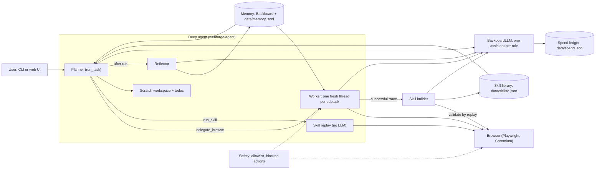
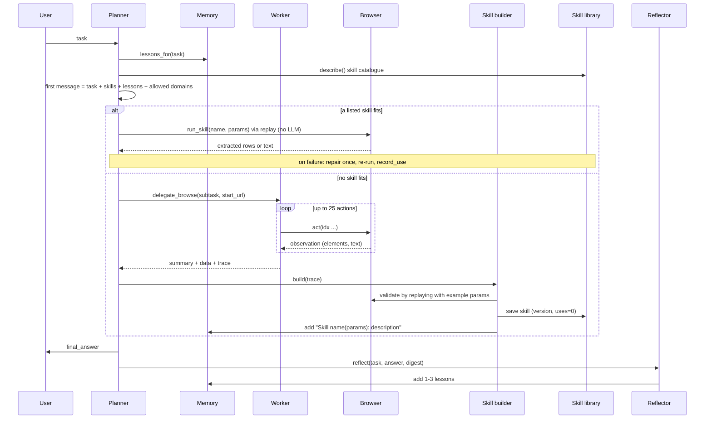
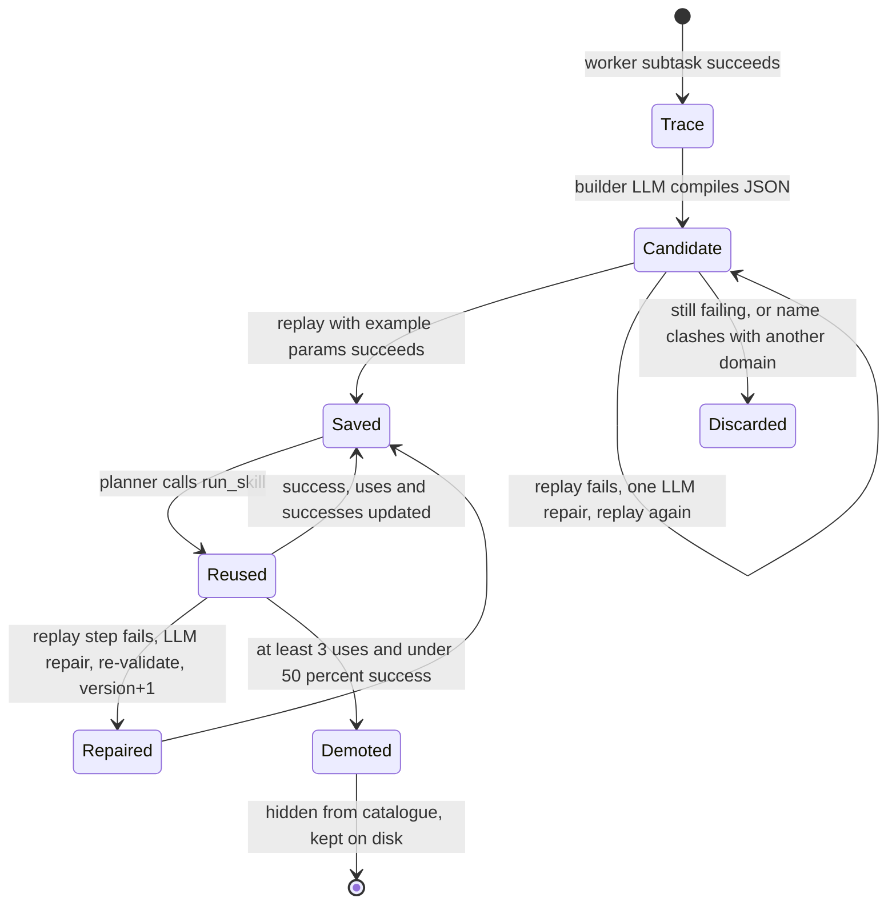

# WebForge architecture

Technical reference for the report. Every statement below was checked against the code in `webforge/` and `bench/`; file names are given so it can be re-checked.

## 1. Goals

1. Complete multi-step web tasks with an LLM that drives a real browser (a "deep agent": plan, delegate, scratch workspace, sub-agents).
2. Make the agent measurably cheaper and faster on repeated *kinds* of task by compiling what worked into **skills** that replay without an LLM.
3. Keep that learning inspectable and bounded: skills are plain JSON, validated by replay before being saved, repaired or demoted when they break.
4. Keep spend and blast radius small: hard dollar cap, blocked actions, untrusted page text, optional domain allowlist.
5. Be demonstrable offline (mock LLM, local fixture site) and reproducible (programmatic benchmark checkers).

## 2. Components



| Module | Responsibility |
|---|---|
| `webforge/contracts.py` | Shared dataclasses and protocols (`Observation`, `TraceStep`, `Skill`, `LLM`, `Memory`, `RunResult`, event kinds). |
| `webforge/agent/planner.py` | `run_task()`: the orchestrator loop and the planner's tools. Builds skills after successful delegations, repairs failing skills, calls the reflector. |
| `webforge/agent/worker.py` | `run_worker()`: browsing sub-agent. New LLM thread per subtask (context isolation), max `worker_max_steps` (25) actions. |
| `webforge/agent/reflector.py` | Distils 1-3 lessons per run into memory (`kind` = `lesson` on success, `failure` otherwise). |
| `webforge/agent/prompts.py` | System prompts and tool schemas for planner and worker. |
| `webforge/browser/` | `Browser` (Playwright wrapper), injected observation JS, locator resolution, row extraction. |
| `webforge/skills/` | `SkillLibrary` (JSON files), `SkillBuilder` (LLM compiles a trace), `run_skill` (LLM-free replay). |
| `webforge/llm.py` | `BackboardLLM` (real), `MockLLM`/`ScriptedMock` (offline), retry, spend ledger. |
| `webforge/memory.py` | `BackboardMemory` (semantic search, JSONL mirror) and `LocalMemory` (keyword overlap). |
| `webforge/safety.py` | Domain allowlist, sensitive-input and risky-click checks. |
| `webforge/server.py` | FastAPI app: runs, SSE event stream, skills/memory/bench endpoints, serves `web/`. |
| `bench/` | Task file, runner, checkers, aggregation and report. |

### Roles and tools

The planner never touches the browser. Its tools (`agent/prompts.py`):

| Tool | What it does | Parallel |
|---|---|---|
| `web_search(queries)` | Backboard call with `web_search="Auto"` (role `searcher`, no browser): short answer with sources per query | yes, one call per query |
| `read_urls(urls)` | opens each URL in its own tab and returns its readable main content; full text saved to `pages/<host>-<n>.md` | yes, one tab per URL |
| `delegate_browse(subtask, start_url)` | one interactive worker (own LLM thread) on the default tab | - |
| `parallel_browse(subtasks)` | one worker per subtask, each with its own LLM thread **and** its own tab; results merged | yes |
| `run_skill`, `list_skills` | replay learned skills (no LLM) | - |
| `write_todos`, `write_file`, `read_file(name, offset, limit)` | plan and workspace | - |
| `final_answer` | ends the run | - |

Concurrency is capped by `WEBFORGE_PARALLEL` (default 4) with an `asyncio.Semaphore`. The browser is split into `Browser` (Chromium process + context) and `Tab` (one page with its own trace and observation); `Browser.new_tab()` gives isolated tabs, and `Browser` still delegates the single-tab API to a default tab. Skill building after `parallel_browse` runs sequentially, on each worker's own tab, so the library sees no concurrent writes. Every worker event carries an `agent` id (`w1`, `w2`, ...) that both UIs show as a lane tag.

The worker's tools: `goto`, `click`, `type`, `select`, `press`, `scroll`, `back`, `extract(css, fields)`, plus selector-free readers that work on any site: `read(offset)` (main content as text with headings, lists and table rows, in 6000-char pages), `tables()` (rows keyed by header), `links(filter)`, `find(text)` (scroll to a phrase, return context) and `structured()` (JSON-LD and OpenGraph/meta: prices, dates, ratings), and `done`.

**Context management.** Any planner tool output over 3000 characters is written in full to the run workspace (`results/<tool>-<n>.md`) and the planner receives a preview plus the file name; worker `done.data` over 1500 characters is saved the same way. `read_file` pages through files with `offset`/`limit`, so a long task keeps its findings without overflowing the planner's context (the deep-agents "file system as memory" pattern).

**Memory relevance.** Backboard memory search ranks unrelated lessons at about 0.9, so recall is re-ranked locally: a lesson is used only if it shares the task's site (metadata `domain`) or at least two informative words with it (`memory.relevant`). The reflector also drops lessons about network failures, which depend on the machine rather than the site.

A run ends when the planner calls `final_answer` (`RunResult.ok = True`), or when it exhausts `planner_max_steps` (30) tool rounds or stalls.

## 3. One run, including skill reuse



Details that matter:

* The planner's first message contains the task, today's date, the allowlist (or "any public website"), the step limit, the skill catalogue (`library.describe()`, demoted skills excluded) and memory hits.
* Skills are only built when `learn=True` and a delegated subtask succeeded with a non-empty trace (`maybe_build`).
* If the model answers in prose instead of calling a tool, the planner nudges it; at most 3 *consecutive* nudges are allowed, then the run stops with `ok=False`. (A bug counted nudges cumulatively; fixed in commit `a4ab12a`.)
* `RunResult.steps` counts worker `act()` calls plus the number of steps of every executed skill.

## 4. Backboard integration (`webforge/llm.py`)

WebForge uses [Backboard](https://backboard.io) as the single LLM gateway (`backboard-sdk`), routed to `WEBFORGE_PROVIDER` / `WEBFORGE_MODEL` (defaults `anthropic` / `claude-haiku-5-5`).

* **Assistants per role.** One Backboard assistant per role (`webforge-planner`, `-worker`, `-builder`, `-reflector`) plus `webforge-knowledge` for memory. Ids are cached in `data/state.json`; if absent, the assistant is looked up by name with `list_assistants` and created only if missing. Creation is guarded by an `asyncio.Lock`.
* **Tool-call loop.** `chat()` calls `client.send_message(message, assistant_id, thread_id, tools, llm_provider, model_name, system_prompt, memory=None[, json_output=True])`. If the reply has tool calls, the caller executes them and calls `submit()`. Repeat until a reply with no tool calls.
* **Tool results go back as a message.** Measured live: after `submit_tool_outputs_simple`, Backboard stores an *empty* assistant turn (no text, no tool calls), so the model can never chain a second tool round from that path; every round needed an extra "nudge" LLM call. `submit()` therefore sends the results as a `TOOL RESULTS` message on the same thread, with the thread's tools and system prompt, which returns `REQUIRES_ACTION` with the next tool calls directly. It falls back to the native submit on error, and `WEBFORGE_TOOL_TRANSPORT=submit` restores it.
* **Status is authoritative.** `_account()` only trusts `tool_calls` when the response status is empty or `REQUIRES_ACTION`. After a submit, Backboard returns `COMPLETED` responses that still echo the previous `tool_calls`; treating those as new calls would loop forever, so they are discarded.
* **System prompt per thread.** The system prompt is sent when a thread starts and remembered per `thread_id`; later `chat()` calls on the same thread that pass `system=""` reuse it.
* **Usage and cost** are read from the last message of each response (`total_tokens` or input+output, and `cost_usd` as reported by Backboard) and accumulated (`calls`, `tokens`, `cost_usd`); `RunResult` reports the delta over a run.
* **Retries.** `_retry` makes up to 3 attempts with 1 s then 2 s back-off for network errors, 5xx and 429; other 4xx errors are raised immediately.
* **Memory.** `BackboardMemory` writes each memory to a local JSONL mirror first (source of truth), then to Backboard (`add_memory`); `search` uses `search_memories` and, because search results carry no metadata, restores metadata from the mirror; on any error it falls back to local keyword-overlap ranking. `list` merges both sources; `reset` clears both. Failures to reach Backboard never fail a run.
* **Offline.** `MockLLM` takes a handler returning text and/or tool calls; `ScriptedMock` replays per-role scripts. `make_llm(mock=True)` returns an always-"ok" `MockLLM`. The test suite uses these, so it needs neither network nor key.

## 5. Observation format and robust locators (`browser/observe.py`)

Each step the worker is shown (`Observation.render`):

```
URL: https://books.toscrape.com/
TITLE: All products | Books to Scrape - Sandbox
INTERACTIVE ELEMENTS:
[0] link 'Books'
[1] link 'Poetry'
[2] textbox 'Search' value='...'
PAGE TEXT:
...
```

* An injected script indexes visible elements matching `a[href], button, input:not([type=hidden]), select, textarea, [role=button], [onclick]` (cap 150 in the page; the worker renders at most 100 elements and 2,500 characters of text). Indices are stamped on the DOM as `data-wf-idx` and are valid only for the latest observation; a stale index returns an error ("observe again").
* Each element also gets a **robust locator** stored in the trace, chosen in this order: `{role, name}` when the accessible name is non-empty, not truncated, and unique for that role; else `{placeholder}` for inputs; else `{text}` when unique; else `{css}` built from stable ids and non-generated class names (classes that contain 3+ digits or are longer than 25 characters are ignored) with `:nth-of-type` where needed.
* On replay (`browser/actions.py`) candidates are tried in the order role+name, placeholder, text, css; the first candidate that has a visible match wins (up to the first 10 matches are inspected). Locator strings may contain `{param}` templates filled by `contracts.fill_template`.
* Row extraction (`extract(css, fields)`): `fields` maps a name to `"sel"` (text), `"sel@attr"` (attribute) or `"@attr"` (attribute of the row itself).

## 6. Skills

### Format

A skill is one JSON file (`data/skills/<name>.json`), the serialisation of `contracts.Skill`:

```json
{
  "name": "extract_category_books_sorted_by_price",
  "domain": "books.toscrape.com",
  "description": "Opens a books.toscrape.com category from the side navigation and extracts every book listed in it (title and price)...",
  "params": ["category"],
  "steps": [
    {"action": "goto",  "locator": null, "value": "https://books.toscrape.com/"},
    {"action": "click", "locator": {"role": "link", "name": "{category}"}, "value": null}
  ],
  "extract": {"type": "css", "selector": "article.product_pod",
              "fields": {"title": "h3 a@title", "price": ".price_color"}},
  "uses": 1, "successes": 1, "version": 1
}
```

(This is a skill produced by a live run, with the description shortened and whitespace compacted. Allowed step actions: `goto`, `click`, `type`, `select`, `press`, `scroll`, `wait`. `extract.type` is `css` or `text`.)

### Lifecycle



1. **Build** (`SkillBuilder.build`): only successful, `ok` steps of kind goto/click/type/select/press are shown to a `builder`-role LLM, which returns JSON with generalised `{param}` templates and `example_params`. Output is parsed leniently (fences and prose tolerated) and normalised (snake_case name, allowed actions, extract spec; any `{param}` found in steps is added to `params`).
2. **Validate by replay**: the candidate is executed in the live browser with `example_params` (`run_skill`); it is saved only if every step and the extraction succeed. On failure, one repair round (the failing step index, error and current observation go back to the LLM), then a second replay; otherwise the skill is discarded and the reason kept in `builder.last_error`. A skill whose name already exists under a *different domain* is rejected; the same name on the same domain bumps `version`.
3. **Reuse** (`run_skill`): fills templates, executes each step through `act_locator`, then extracts. Missing params fail fast. `uses`/`successes` are recorded after each planner call.
4. **Repair at run time**: if a replay fails at a step, `SkillBuilder.repair` asks the LLM for a corrected skill (name fixed), validates it by replaying with the current params, and on success saves it with `version + 1`, keeping `uses`/`successes`, then the planner re-runs it. If repair fails the planner is told to fall back to `delegate_browse`.
5. **Demote** (`library.is_demoted`): `uses >= 3` and `successes / uses < 0.5`. Demoted skills are excluded from the catalogue and listings by default (`skills list` shows them as "(demoted)"). There is no automatic promotion back.

Skills also create a memory entry (`kind: "skill"`) so they can be recalled semantically.

## 7. Memory and reflection

After each run with `learn=True` the reflector (`reflector` role, JSON output) receives the task, outcome, answer and a digest of what happened and returns up to 3 `{domain, text}` lessons (site structure, selectors, pitfalls; not the answer itself). They are stored with metadata `{domain, kind: lesson|failure, task}`. On later runs, `lessons_for(task)` seeds the planner's first message, and `lessons_for(subtask + start_url)` is passed to each worker as hints. This is retrieval, not fine-tuning: nothing in the model changes.

## 8. Safety model

| Control | Where | What it does |
|---|---|---|
| Domain allowlist (optional) | `safety.check_action`, `Browser._goto` | Off by default (open web). When `WEBFORGE_ALLOWED_DOMAINS` is set, `goto` to other hosts (subdomains included; `localhost` and `127.0.0.1` always allowed) is refused, both for LLM-driven actions and for skill replay. |
| Sensitive input | `safety.check_action` | `type`/`select` into elements whose name/role/locator look like password, card number, CVV, SSN fields is refused. |
| Risky clicks | `safety.check_action` | Clicking elements named like checkout, pay now, place order, buy now, sign in, log in, delete account, confirm order/purchase is refused. |
| Untrusted page text | prompts | Planner and worker prompts instruct the model to treat page text and tool output as data and never follow instructions found there. This is a prompt-level mitigation, not an enforced boundary. |
| Spend cap | `llm._guard` | See section 9. |
| Server | `server.py` | Optional `WEBFORGE_ACCESS_CODE` (constant-time compare) for starting runs and destructive endpoints; destructive endpoints are loopback-only when no code is set; CORS closed by default when a code is set; task length 500 chars; one run at a time (HTTP 409). |

Limits of the model: the allowlist is checked on `goto`, not on every network request, so a click that follows a link or redirect to another host is not blocked by it; the risky-click and sensitive-field checks are regex heuristics on visible names. Run errors are scrubbed of the Backboard key before they are stored or shown.

## 9. Cost control

* `WEBFORGE_BUDGET_USD` (default 3.0) is a hard cap on **cumulative** spend. `BackboardLLM._guard()` reads the global ledger (`data/spend.json`, path `WEBFORGE_LEDGER`) before every `chat` and `submit` and raises `BudgetExceeded` once the total reaches the cap. The server additionally returns HTTP 402 before starting a run.
* The ledger is independent of the data directory used by a run, so benchmark runs (which use isolated data dirs) count toward the same cap.
* The check happens before a call, so one in-flight call can overshoot the cap slightly; the ledger update is serialized with an exclusive file lock (`flock`), so parallel processes do not lose updates (an earlier unlocked version did, which is why it was fixed); the check-before-call design still lets a single in-flight call overshoot.
* Cost per call is whatever Backboard reports; the default model is a small, cheap one. Per-run limits (25 worker actions, 30 planner rounds, 300 s per benchmark task) bound runaway loops.

## 10. Benchmark methodology (`bench/`)

* **Tasks**: `bench/tasks.yaml`, 9 tasks in 3 families (`books_category`, `quotes_by_tag`, `wiki_summary`), three variants each, run in file order. The first variant of a family is where a skill can be learned; later variants should transfer.
* **Modes**: `cold` runs with `learn=False`, memory and skills off, and wipes the benchmark's skill directory and memory mirror before every task. `learned` runs with learning, memory and skills on, and lets skills and memory accumulate across tasks (and across repeats). Both modes use the same model, tasks and live websites, and write to an isolated data directory (`data/bench_<mode>_<ts>/`), so the interactive skill library is never touched.
* **Repeats**: `--repeat N` loops over the whole task list N times (repeat is the outer loop).
* **Correctness** is checked programmatically against the final answer (`contains_all`, `contains_any`, `regex`, `min_matches`); a task is correct only if the planner also finished (`ok`). Per task the JSONL records steps, LLM calls, tokens, cost, seconds, skills used/created, and a 500-char answer excerpt. A per-task timeout of 300 s applies.
* **Report**: `python -m webforge bench report <cold.jsonl> <learned.jsonl>` prints success rate and mean steps/tokens/seconds per scope with percentage changes (and a PNG if matplotlib is installed).

### Threats to validity

* **Small samples.** 9 tasks (and 27 with three repeats) on a stochastic model; differences within one or two tasks are not significant. No confidence intervals are computed.
* **Weak checkers.** `books_category` and `quotes_by_tag` check answer *format* (at least three prices / attributions), not that the *right* books or quotes were returned. The Travel answer in the single-pair live test was additionally verified by hand against the live site; the benchmark checkers were not.
* **Learned mode leaks across repeats.** With `--repeat > 1`, skills built during repeat 1 are available to the same tasks in repeats 2 and 3, so later repeats measure reuse of an exact-match skill, not only transfer to a new variant.
* **Live sites drift** (Hacker News, Wikipedia), and API latency varies; seconds are noisy.
* **Learning overhead.** Learned-mode totals per task include the extra builder and reflector calls in the first run of a family; cold mode skips them. The reported `steps` count includes skill steps.
* **Families with nothing to learn.** Quotes and Wikipedia tasks are already solved in ~1 step by the model, so they cannot show a gain.
* **Single model, single provider.**

## 11. Known limitations

* Needs Chromium and a Backboard key; cannot run on Vercel's serverless runtime.
* Skills are tied to a site's structure; a redesign triggers repair or demotion rather than silent failure, but repair costs LLM calls and can fail.
* Skill builder validates against the live site once; a skill that passes may still encode an accidental dependency (for example sort order on the page).
* Demotion is permanent (no re-promotion); the planner picks skills from natural-language descriptions, so it can choose a poorly fitting one.
* One browser tab context; no login, payment, file upload/download, CAPTCHA or iframe-specific handling.
* Small models sometimes answer in prose instead of calling a tool; the nudge mechanism mitigates but does not eliminate this.
* `serve --headed` (or `WEBFORGE_HEADED=1`) shows the real browser window for live demos; `run --headed` does the same for the CLI.
* Local-only state: skills, memory mirror and ledger live under `data/`; on ephemeral hosts they reset unless a disk is mounted.

## 12. Future work

* Parameter-type inference and skill composition (one skill calling another).
* Skill promotion after repair, and success-rate tracking per version.
* Stronger answer checkers (ground-truth data per task) and larger benchmarks with confidence intervals.
* Network-level allowlist enforcement (request interception) and secret redaction in logs.
* Multiple concurrent runs with isolated browser contexts and a locked ledger.
* Vision fallback for pages without useful accessible names.
